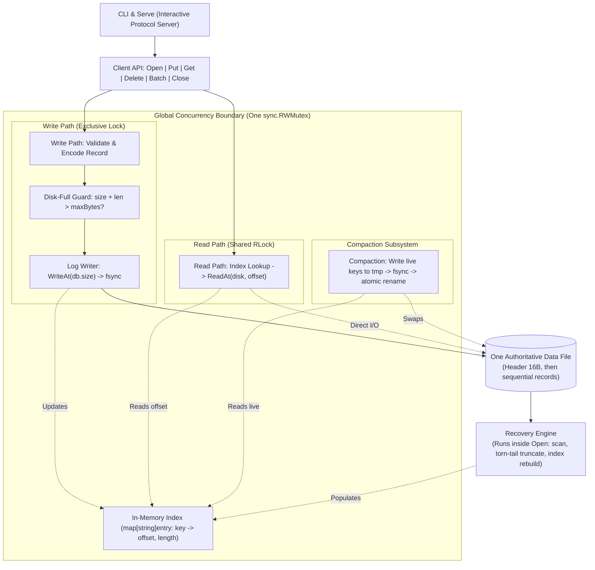
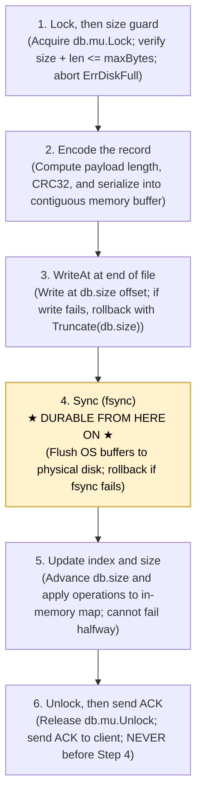
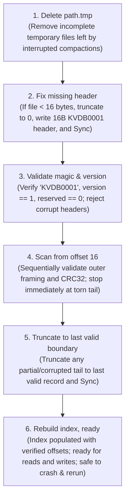

# KillItDB Architecture & Crash-Safety Specification

This document details the architectural design, storage layout, concurrency model, write pipeline, and crash recovery mechanics of **KillItDB**—a crash-proof embedded key-value database engine built for the 24-hour hackathon *"Kill It and Prove It"*.

---

## 1. System Overview



### Core Architecture Principles
1. **Single Authoritative Data File:** All data, keys, values, headers, batches, and tombstones live sequentially in one single on-disk file. No separate WAL files, no auxiliary journal files, no sidecar indexes.
2. **Crash-Safety First:** Every successful operation is guaranteed to survive an instantaneous kernel panic, power loss, or `kill -9` (SIGKILL).
3. **Values Remain on Disk:** The in-memory index stores only 12-byte pointers (`valueOffset int64` + `valueLen uint32`). Values are never cached or held in RAM; point lookups issue zero-copy direct `ReadAt` requests.
4. **All-or-Nothing Atomicity:** Multi-operation batches are encoded into **exactly one binary record**. A batch never recovers partially.
5. **Standard Library Only:** Zero external dependencies; built purely with Go standard library (`os`, `sync`, `hash/crc32`, `encoding/binary`).

---

## 2. On-Disk Binary Format

Every database file starts with a fixed 16-byte header, followed by contiguous append-only records.

### 2.1 Authoritative 16-Byte Header
```
+-----------------------------------+-------------------+-------------------+
|            Magic (8B)             |   Version (4B)    |   Reserved (4B)   |
|          "KVDB0001"               |   uint32 (LE: 1)  |   uint32 (LE: 0)  |
+-----------------------------------+-------------------+-------------------+
0                                   8                   12                  16
```

### 2.2 Record Framing (Outer Structure)
Every write—whether a single `Put`, a single `Delete`, or a 10,000-operation `Batch`—is stored as **exactly one record**:
```
+-------------------+-------------------+-----------------------------------+
| Payload Len (4B)  |    CRC32 (4B)     |              Payload              |
|   uint32 (LE)     |  IEEE 802.3 (LE)  |         (N bytes variable)        |
+-------------------+-------------------+-----------------------------------+
0                   4                   8                                   8 + PayloadLen
```
- **CRC32 Checksum:** Covers the 4-byte `Payload Length` field followed by the `Payload` bytes. It explicitly excludes the 4-byte CRC field itself.

### 2.3 Payload Structure (Inner Operations)
```
+-------------------+-------------------------------------------------------+
|  Op Count (4B)    |                  Repeated Operations                  |
|   uint32 (LE)     |    [Type (1B)] [KeyLen (2B)] [ValLen (4B)] [Key] [Val]   |
+-------------------+-------------------------------------------------------+
0                   4
```
- **Type (uint8):** `1` = `PUT`, `2` = `DELETE`.
- **Key Length (uint16):** $1 \le \text{KeyLen} \le 1,024$ bytes.
- **Value Length (uint32):** $0 \le \text{ValLen} \le 1,048,576$ bytes (1 MB). For `DELETE`, `ValLen` is strictly `0`.

---

## 3. Write Ordering Pipeline

To guarantee that an un-persisted record is never visible to concurrent readers or mistakenly acknowledged, writes follow a strict 6-step ordering discipline:



### Invariants Maintained During Writes:
1. **Never ACK before `fsync`:** An operation is only acknowledged after physical synchronization succeeds. If the process is killed before Step 4, the operation is unacknowledged and will be cleanly ignored or truncated on recovery.
2. **Never index before `fsync`:** In-memory state is updated **only** after disk persistence is confirmed. Readers cannot observe uncommitted writes.
3. **Disk-Full Pre-Check:** If a write or midway batch item crosses `--max-bytes`, the operation is aborted before touching the disk. Zero bytes are written.

---

## 4. Recovery on Open Pipeline

When a database is opened (`Open()`), the engine runs `recoverDatabase()` to guarantee repeatable and idempotent recovery even if repeatedly interrupted by `kill -9`:



### Recovery Invariants:
1. **Torn-Tail Truncation:** If a crash occurred during a write (e.g. half-written record or corrupted CRC), the scan halts at the last valid boundary. The torn tail is truncated and physical sync issued.
2. **Idempotence:** Recovery can be killed at any step (even mid-truncation). Running `Open()` again will resume cleanly from disk state.
3. **Zero-Heap Value Loading:** Recovery only scans headers and keys; value bytes are skipped via relative offset calculation. This allows scanning 1,000,000 keys in $\approx 440\text{ ms}$.

---

## 5. Read Path & Concurrency

Concurrency is managed by a single global `sync.RWMutex`:

- **Concurrent Readers (`Get`):**
  1. Acquire `db.mu.RLock()`.
  2. Query `db.index` for key. If not present, return `ErrKeyNotFound`.
  3. Perform positional `db.file.ReadAt(buf, entry.valueOffset)` directly from the file descriptor.
  4. Release `db.mu.RUnlock()`.
  - Multiple readers execute concurrently without blocking each other.
- **Exclusive Writers (`Put`, `Delete`, `Batch`, `Compact`):**
  - Acquire `db.mu.Lock()`.
  - Fully exclusive: no reads can observe partially written records or midway batch states.

---

## 6. Compaction Subsystem

Because the engine is append-only, updates and deletions accumulate dead records over time. Compaction reclaims this space safely:

1. **Acquire Write Lock:** `db.mu.Lock()` ensures zero interference from concurrent writers.
2. **Create Temporary File:** Opens `<path>.tmp` and writes a fresh 16-byte header.
3. **Iterate Live Keys:** Reads each live key from `db.index`, reads its value via `ReadAt`, and writes a clean sequential `OpPut` record into `<path>.tmp`.
4. **Physical Sync:** Calls `fsync` on `<path>.tmp` to guarantee complete durability of the new compacted file.
5. **Atomic Swap:**
   - Closes the active file handle and temporary file handle.
   - Atomically renames `<path>.tmp` over `<path>` (`os.Rename`).
   - Reopens `<path>` and runs `recoverDatabase()` to update internal offsets.
6. **Crash Invariant:** If killed before rename, `<path>` remains 100% intact and `<path>.tmp` is deleted on the next `Open()`. If killed after rename, the new compacted file is authoritative.

---

## 7. Crash Matrix: What is on disk if the process dies?

| Failure Point | On-Disk State | Post-Recovery Outcome |
|---|---|---|
| **Dying during Step 1 (Size guard / Lock)** | Exactly the previous valid records. 0 bytes added. | Clean recovery. State identical to before write. |
| **Dying during Step 2 (Memory encoding)** | Unchanged. Record only existed in RAM. | Clean recovery. Unacknowledged write discarded. |
| **Dying during Step 3 (WriteAt midway)** | Trailing partial bytes written to disk. | Torn tail detected; truncated back to old size; 0 partial state exposed. |
| **Dying during Step 4 (Sync/fsync in progress)** | Record written, but may not be physically durable. | If CRC valid, record survives; if incomplete/bad CRC, truncated cleanly. |
| **Dying after Step 4, before Step 5 (Sync done, before Index update)** | Record is 100% physically durable on disk. | Recovery scans and loads the record into the index. Write survives! |
| **Dying during Step 6 (Before sending ACK)** | Record is 100% physically durable on disk. | Recovery loads the record. All-or-nothing atomicity preserved. |
| **Dying during Compaction (Step 3 or 4)** | Old DB file untouched; `<path>.tmp` contains partial data. | Recovery deletes `<path>.tmp`; old DB continues unchanged. |
| **Dying after Compaction atomic rename** | New compacted DB file is in place on disk. | Recovery scans compacted file; obsolete records successfully purged. |

